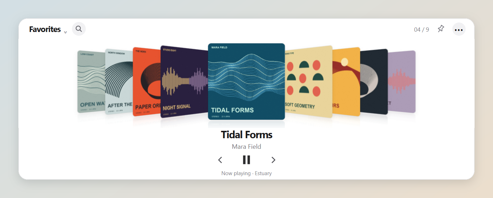
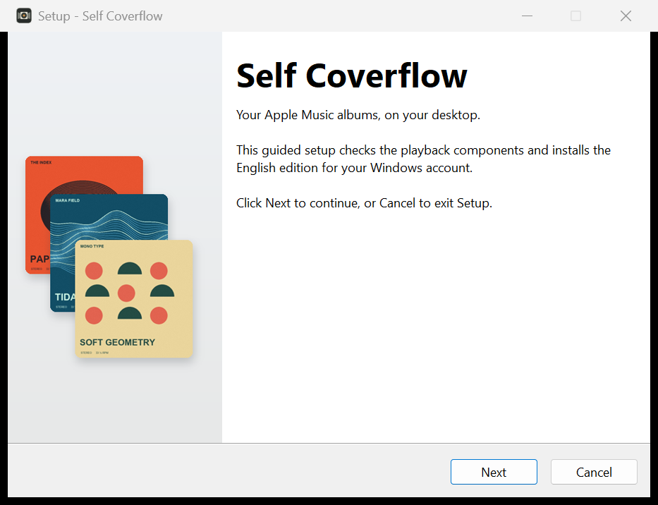
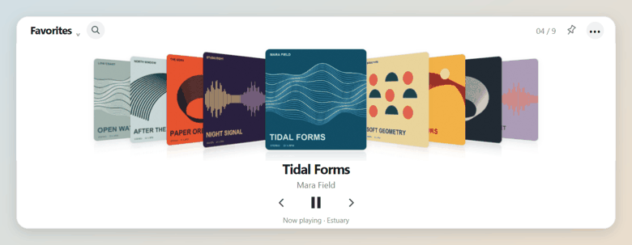

# Self Coverflow · 唱片架

[简体中文](README.zh-CN.md) · [Releases](https://github.com/Flapflops3/Self-Coverflow/releases)

A white **Cover Flow desktop widget for Apple Music** on Windows and macOS. Flip through the albums in your local Music library, find a record by its artwork, and double-click to play it in Music. Pin the shelf above your workspace or stretch it across a second monitor.

## Download

Choose your system and language. English and Simplified Chinese are separate applications.

| System | English | 简体中文 |
| --- | --- | --- |
| Windows x64 | [Download for Windows · EN](https://github.com/Flapflops3/Self-Coverflow/releases/download/v1.0.0-beta.1/Self-Coverflow-Windows-x64-en-Setup.exe) | [下载 Windows 中文版](https://github.com/Flapflops3/Self-Coverflow/releases/download/v1.0.0-beta.1/Self-Coverflow-Windows-x64-zh-Setup.exe) |
| macOS 13+ · Apple silicon and Intel | [Download for Mac · EN](https://github.com/Flapflops3/Self-Coverflow/releases/download/v1.0.0-beta.1/Self-Coverflow-macOS-universal-en.pkg) | [下载 Mac 中文版](https://github.com/Flapflops3/Self-Coverflow/releases/download/v1.0.0-beta.1/Self-Coverflow-macOS-universal-zh.pkg) |

**Windows 10 22H2 / Windows 11 (x64).** Run the downloaded `Setup.exe`. The wizard checks Apple Music and WebView2, opens the Microsoft Store if you need Music, and installs Microsoft's WebView2 Runtime if missing. You can choose a desktop shortcut and start-with-Music option. Open the installed edition from the Start menu. This beta installer is unsigned.

**Mac.** Open the downloaded `.pkg` and follow the system Installer. Launch the app from Applications, then allow it to control Music. Review permissions in System Settings → Privacy & Security → Automation. The beta package is unsigned, the app is ad-hoc signed, and Apple has not notarized it. [Apple’s guide to opening a trusted app](https://support.apple.com/guide/mac-help/mh40616/mac)

**First playback check.** Open Music, sign in and confirm you can play a track directly. In Self Coverflow, choose All Albums, double-click a record, and check the current song beneath the playback controls. Use **••• → Refresh library** after your first sync.

## Browse and play

| Gesture | Result |
| --- | --- |
| Scroll or drag horizontally | Browse the covers. After ordinary browsing, the shelf rolls back to the playing album. |
| Click the magnifying glass, type, press Enter | Search album titles and artists. The result stays centered while you decide what to play. |
| Double-click a cover | Start that album in the local Music app. |
| Drag a cover upward and release | Center the cover, request playback and open the lyrics panel. |
| Click the pin or open **•••** | Pin the shelf, choose Classic / Half / Full width, or turn off Simulation Effects. All widths keep the same height. |

**Lyrics vary by platform.** Windows follows lyrics exposed by the Apple Music client. macOS reads the track’s lyrics field in Music. Timestamped LRC lines support highlighting and click-to-seek. Some streaming tracks expose their synchronized lyrics only inside Music.

Self Coverflow reads library data locally. macOS caches artwork on this Mac. Playback uses your existing Music account. The screenshots use original demonstration artwork. Self Coverflow is an independent project.

## Build

Windows sources and WebView2 notices are under `windows/`. Build both setup programs with `tools/build-windows-installer.ps1 -ISCC "path/to/ISCC.exe"` and Inno Setup 6.6.1. macOS uses AppKit, WebKit and Music automation. On a Mac with Xcode command-line tools, run `bash mac/build.sh` to build both universal apps and their native installer packages. Output is under `dist/`.

The disc effect is adapted from “CD drive spin” by 607freesound, released under CC0. [Original recording](https://freesound.org/people/607freesound/sounds/550459/)

