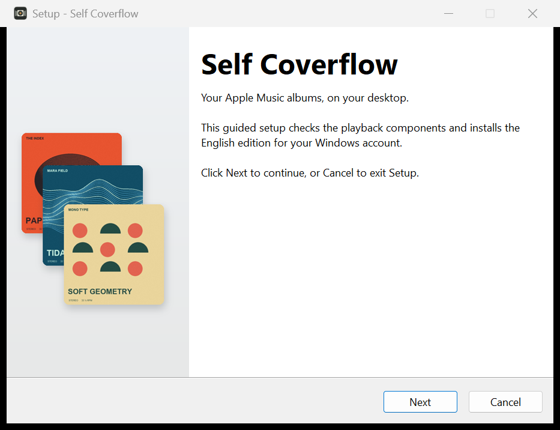
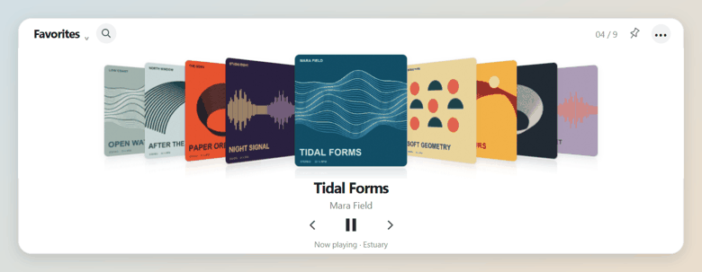

# 唱片架 · Self Coverflow

[English](README.md) · [版本发布](https://github.com/Flapflops3/Self-Coverflow/releases)

一个给 **Windows 和 macOS 版 Apple Music** 使用的白色桌面唱片架。用 Cover Flow 翻看本机资料库，按封面挑唱片，双击就在音乐 App 中播放。可以在副屏铺开，也可以置顶成一条紧凑的小窗。

## 下载

中文和英文分别打包，按系统选择即可。

| 系统 | 简体中文 | English |
| --- | --- | --- |
| Windows x64 | [下载 Windows 中文版](https://github.com/Flapflops3/Self-Coverflow/releases/download/v1.0.0-beta.2/Self-Coverflow-Windows-x64-zh-Setup.exe) | [Windows 英文版](https://github.com/Flapflops3/Self-Coverflow/releases/download/v1.0.0-beta.2/Self-Coverflow-Windows-x64-en-Setup.exe) |
| macOS 13 或更新版本，支持 Apple 芯片及 Intel | [下载 Mac 中文版](https://github.com/Flapflops3/Self-Coverflow/releases/download/v1.0.0-beta.2/Self-Coverflow-macOS-universal-zh.pkg) | [Mac 英文版](https://github.com/Flapflops3/Self-Coverflow/releases/download/v1.0.0-beta.2/Self-Coverflow-macOS-universal-en.pkg) |

**Windows 10 22H2 / Windows 11（x64）。** 双击下载的 `Setup.exe`。向导会检查 Apple Music 和 WebView2，提供微软商店入口，并在缺少 WebView2 时联网安装微软官方运行时。可选桌面快捷方式、随 Apple Music 启动。完成后在开始菜单找到对应语言的 Self Coverflow。此测试版 Windows 安装程序未签名。

**Mac 用户**双击下载的 `.pkg`，跟随系统安装器完成安装。从「应用程序」打开 Self Coverflow，首次启动时允许它控制「音乐」。授权可在「系统设置 → 隐私与安全性 → 自动化」查看。此测试版安装包未签名，应用采用临时签名，未经 Apple 公证。[Apple 关于打开可信应用的说明](https://support.apple.com/zh-cn/guide/mac-help/mh40616/mac)

**首次试播。** 先在 Apple Music 中登录并确认可以播放，再到唱片架切换「全部专辑」，双击一张封面。底部应显示正在播放的曲名。首次同步完成后，可在「•••」中点「刷新资料库」。

## 怎么用

| 操作 | 效果 |
| --- | --- |
| 滚轮或横向拖动 | 翻看专辑，停一会儿后滚回当前正在播放的唱片 |
| 点放大镜，输入专辑或艺人，按回车 | 结果滚到中央并停住，可以从容双击播放 |
| 上一首 / 下一首 | 在当前专辑内切歌。 |
| 下一首右边的循环键 | 切换专辑循环与单曲循环。在 Mac 上，专辑循环会在「音乐」中创建可复用的专辑播放列表。 |
| 双击封面 | 通过本机 Apple Music 开始播放 |
| 上滑封面并松手 | 选中这张唱片，后台请求播放并展开歌词 |
| 点图钉或右上角「•••」 | 置顶、切换三档宽度或开关仿真音效。调宽时高度固定 |

**歌词能力因平台而异。** Windows 跟随 Apple Music 客户端提供的歌词。Mac 读取曲目自带的歌词，有 LRC 时间戳时支持逐行高亮、点击跳转。一些流媒体歌曲的同步歌词只能在「音乐」App 内查看。

唱片架在本机读取资料库，使用现有 Apple Music 账号播放。Mac 会在本机缓存封面。上图使用专门制作的演示唱片。本项目由独立开发者维护。

## 构建

Windows 使用 Inno Setup 6.6.1，运行 `tools/build-windows-installer.ps1 -ISCC "ISCC.exe 的路径"` 生成两个安装程序。在装有 Xcode 命令行工具的 Mac 上运行 `bash mac/build.sh` 可生成两款通用应用及其原生安装包。输出位于 `dist/`。

仿真读盘声改编自 607freesound 发布的 CC0 录音。[原始声音](https://freesound.org/people/607freesound/sounds/550459/)

